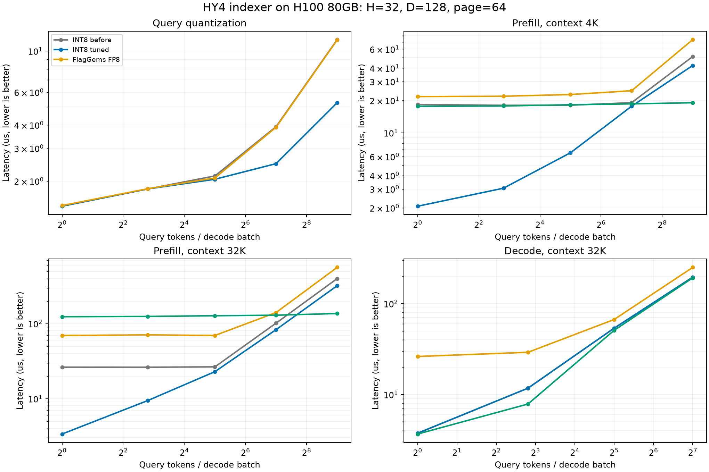

# HY4 INT8 / FP8 microbenchmarks on H100

Measured on 2026-10-21 (Asia/Shanghai), NVIDIA H100 80GB HBM3, 132 SMs,
Torch 2.11.0+cu129, vLLM 0.24.0 and Triton/FlagTree 3.6.
The measured source commits are baseline `7fd0fed43faa8e4b653912cc29f281c5ea9c3e09`
and tuned `1a3db313b11cf200dc0595680f7f6a19392568d3`.

The 44 matched cases use checkpoint-derived H=32, D=128, BF16 source tensors,
UE8M0 Q/K scales, FP32 head weights, page size 64 and TopK=2048. Decode requests
have disjoint physical pages. Components exclude setup; chains include query
quantization, scale folding, cache insertion, prefill gather, logits and TopK.
Linear projections, RoPE, BF16 MLA attention and the rest of the model are outside
this benchmark. H100 runtime selection still uses FP8 by default.

Each provider has 25 warmups, 64 calls per captured graph and seven rounds with
interleaved provider order. Tables show median microseconds. JSON retains every
round and interpolated p10/p90 across round averages. Clocks/power were not
modified. GPU 0 was free at baseline/final start; no claim of exclusive reservation
is made. Torch dispatch is native ATen (`USE_FLAGGEMS=0`); explicit public
FlagGems calls remain enabled. Both formats use the same BF16 source values and
are checked against their own CPU FP64 quantized mathematical reference on the
first and last query/request rows; quantization/cache checks cover every value.

INT8 quantization/cache bytes must match exactly. Logit tolerances remain
`rtol=1e-5, atol=2e-3` for INT8. FP8 uses the existing FP8 operator test's
`atol=5e-2` budget, including native DeepGEMM; its hardware accumulation differs
slightly from the exact decoded CPU dot. No existing test tolerance was relaxed.
TopK checks compare selected reference scores, allowing equivalent cutoff ties.

## Results

Ratios above 1 favor tuned INT8. Geometric means give equal weight to each shape;
there is no measured serving workload distribution. DeepGEMM columns cover logits
only; chain comparisons share the FlagGems cache/gather/TopK implementations.

| Stage | Cases | Before / tuned INT8 | Worst before / tuned | FlagGems FP8 / tuned INT8 | DeepGEMM FP8 / tuned INT8 |
| --- | ---: | ---: | ---: | ---: | ---: |
| query | 5 | 1.29x | 1.00x | 1.28x | — |
| cache | 5 | 1.02x | 1.00x | 0.99x | — |
| prefill | 10 | 2.43x | 1.08x | 3.93x | 3.21x |
| decode | 12 | 1.00x | 0.98x | 2.04x | 0.92x |
| prefill_chain | 6 | 1.36x | 1.07x | 1.73x | — |
| decode_chain | 6 | 1.00x | 0.99x | 1.25x | — |

| Stage | Tokens/batch | Context | INT8 before (us) | INT8 tuned (us) | FlagGems FP8 (us) | DeepGEMM FP8 (us) |
| --- | ---: | ---: | ---: | ---: | ---: | ---: |
| query | 512 | 0 | 11.51 | 5.28 | 11.45 | — |
| cache | 512 | 0 | 2.07 | 2.04 | 2.03 | — |
| prefill | 1 | 4096 | 18.30 | 2.07 | 21.69 | 17.63 |
| prefill | 7 | 4096 | 18.00 | 3.05 | 21.86 | 17.75 |
| prefill | 32 | 4096 | 18.05 | 6.52 | 22.67 | 18.21 |
| prefill | 128 | 32768 | 101.61 | 83.15 | 140.64 | 129.77 |
| prefill | 512 | 32768 | 399.44 | 320.93 | 563.38 | 136.52 |
| decode | 1 | 32768 | 3.73 | 3.75 | 26.20 | 3.67 |
| decode | 128 | 131072 | 765.77 | 765.95 | unsupported | 754.78 |
| prefill_chain | 1 | 4096 | 34.13 | 18.17 | 37.96 | — |
| prefill_chain | 128 | 32768 | 195.33 | 178.32 | 242.70 | — |



Small prefill improves substantially, while the largest prefill cases still trail
native DeepGEMM FP8 (512 tokens / 32K: INT8 320.93us versus 136.52us). Cache
insertion is approximately equal to FP8, with small differences within a few
percent. Decode keeps its original implementation/configurations because tested
alternatives did not produce a stable overall gain. These are operator and
indexer-chain results, not end-to-end model throughput or quality measurements.

## Retained changes and rejected experiments

| Candidate | Evidence / result | Decision |
| --- | --- | --- |
| Small-M row/head matrix | Original M=1 prefill used a 32-row tile, 16 head-pair iterations and 217 registers/thread; row path measures about 2.1us versus 18.3us, with 48 registers in the representative selected kernel | Keep for M<=16 |
| Larger head tiles and pipeline stages | More head work per dot and single-stage choices reduce representative dense latency; 512/32K falls from about 400us to 321us | Keep autotune candidates, retain original choices |
| Full-head row strategy for every M | Large-M cases regress about 27% | Reject; keep tiled dense path |
| Batched Q reductions | At least 1024 groups share CTAs; 512-token quantization falls from about 11.5us to 5.3us, with exact byte/scale checks and refreshed graph replay | Keep |
| Decode BLOCK_N=32/256 and eight-warps variants | Little stable gain; one small batch regresses about 9% | Reject and restore original configs |

Nsight Systems confirms the original prefill kernel takes about 18.5us in the
small example. Compiled register/shared-memory/spill/config records accompany
JSON results; representative kernels have no spills. NCU was unavailable, so no
hardware-counter utilization or measured stall breakdown is claimed.

## Validation and comparison boundary

- All 44 INT8 cases and their Torch references pass; all 22 DeepGEMM logits cases
  pass. The ordinary FlagGems FP8 baseline is valid in 43 cases.
- The largest decode case (batch=128, context=131072) has a 2.06GiB cache pool.
  The current FlagGems FP8 graph kernel computes `physical_page * byte_stride`
  in INT32 and overflows above 2GiB. Its CPU-reference check failed, so this
  provider is explicitly excluded from timing for that case. INT8 uses INT64
  key offsets; native DeepGEMM remains a valid comparison there. FP8 production
  kernels were not modified as part of this optimization.
- The final operator regression run passes 136 tests: 93 INT8, 41 TLE capability
  and two generic BF16 MLA cases. Tests include all supported float inputs,
  head counts, tail tiles, dispatch boundaries, exact quantization and refreshed
  CUDA graph metadata. A100 execution and checkpoint-quality evaluation remain
  separate pending validation.

## Reproduce

From the FlagGems-vllm repository root, with the documented dependencies:

```bash
PYTHONPATH=src USE_FLAGGEMS=0 VLLM_PLUGINS=fl CUDA_VISIBLE_DEVICES=0 \
  python benchmark/bench_hy4_indexer_precision.py --suite core --native-fp8 \
  --output experiments/hy4-int8-h100/reproduced.json
```

The CLI records memory-budget skips instead of displacing other workloads.
`--suite smoke` uses two small shapes per stage. Use `--stages query,cache`,
`prefill,decode` or `prefill_chain,decode_chain` to reproduce a subset.
Raw data: [baseline](../experiments/hy4-int8-h100/baseline.json),
[tuned](../experiments/hy4-int8-h100/tuned.json).
